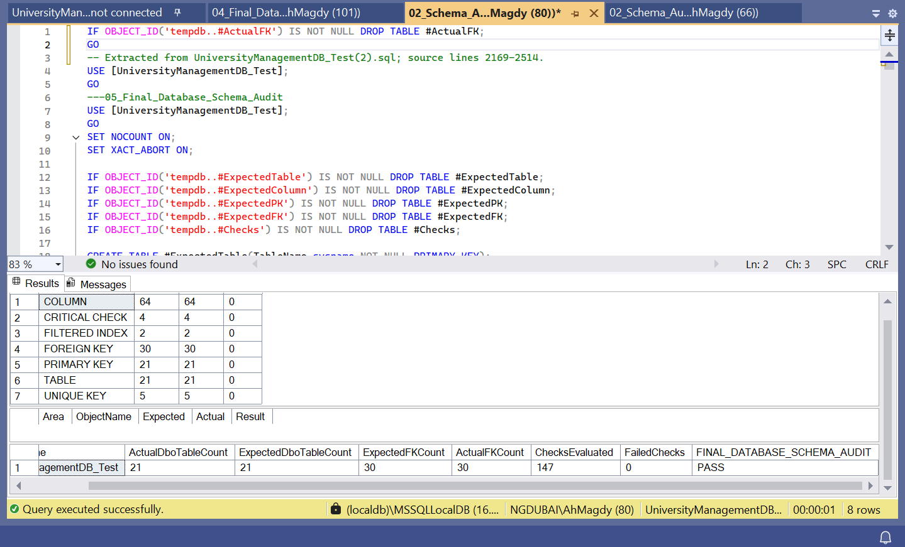
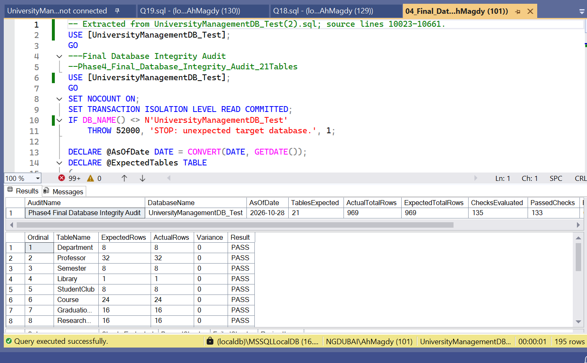
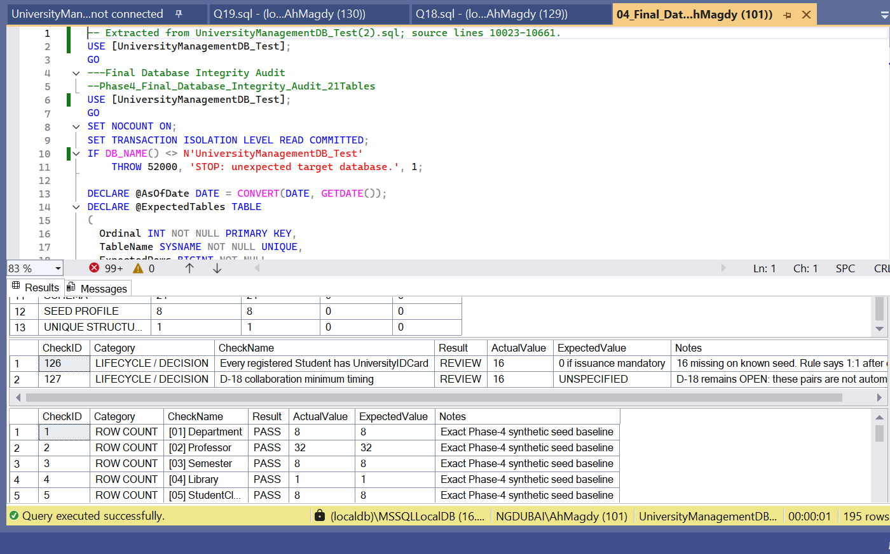
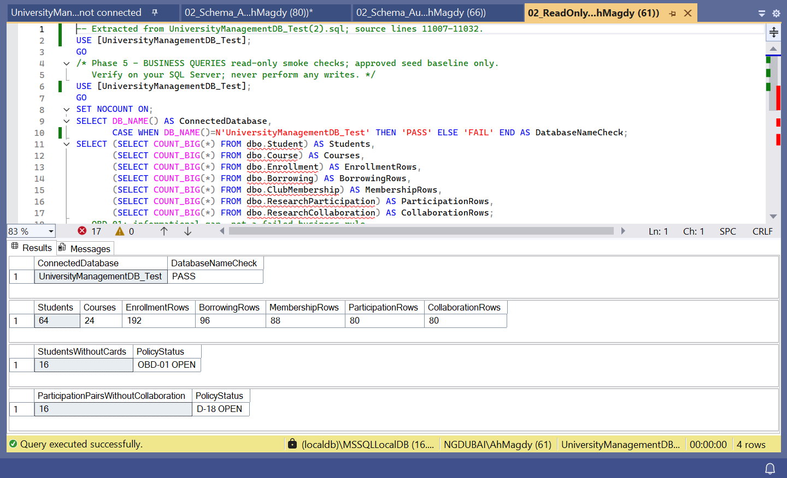
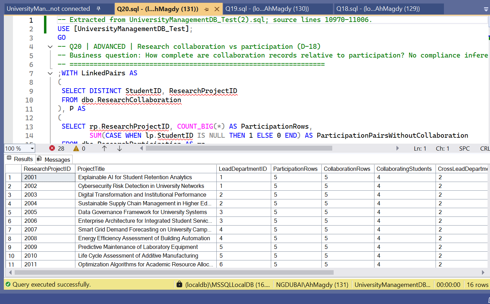

# المرحلة السادسة: Final Project Audit & Closure

يوثّق هذا الملف نتائج اختبار SQL، وأدلة الاختبار، وتسليم تقرير Power BI، والبنود التي ما زالت تحتاج إلى قرار أعمال.

تستند النتائج أدناه إلى نتائج SSMS والصور المقدّمة بتاريخ 28 October 2026، وإلى تأكيد رفع الملفات إلى GitHub. لا يمثل هذا التوثيق تشغيلًا جديدًا للاختبارات أو تحققًا مستقلًا من إعدادات Power BI Service.

## نطاق الاختبار

- قاعدة الاختبار: UniversityManagementDB_Test.
- قاعدة المشروع الأساسية: UniversityManagementDB.
- بيئة التنفيذ الظاهرة: SQL Server LocalDB، باستخدام SSMS.
- عدد جداول المشروع: 21 جدولًا.
- إجمالي بيانات الاختبار: 969 سجلًا، مطابقًا للإجمالي المتوقع.
- فصل نسخة الاختبار عن ملفات المشروع الأساسية ضروري للمحافظة على إعدادات كل نسخة.

## ملخص نتائج SQL

| الفحص | النتيجة المثبتة | الحالة |
| --- | --- | --- |
| فحص Schema Audit | نجح 147 من أصل 147 فحصًا، مع صفر Failed Checks | PASS |
| فحص الجداول | تطابق 21 جدولًا مع العدد المتوقع | PASS |
| فحص الأعمدة | تطابق 64 عمودًا مع تعريفات الفحص | PASS |
| فحص Primary Keys | تطابق 21 Primary Key | PASS |
| فحص Foreign Keys | تطابق 30 Foreign Key | PASS |
| فحص Unique Keys | نجحت الفحوص الخمسة | PASS |
| فحص Filtered Indexes | نجح الفحصان | PASS |
| فحص Critical Checks | نجحت الفحوص الأربعة | PASS |
| فحص Final Integrity Audit | نجح 133 فحصًا، وصفر Failed Checks، وبندان REVIEW، من أصل 135 فحصًا | REVIEW |
| فحص إجمالي البيانات | تطابق 969 سجلًا مع الإجمالي المتوقع | PASS |
| فحص Phase 5 Smoke Checks | أظهر اسم قاعدة الاختبار الصحيح والأعداد المتوقعة، مع إظهار القرارين المفتوحين | PASS مع بنود أعمال مفتوحة |

نجاح تنفيذ الاستعلام في SSMS يعني أن التنفيذ اكتمل؛ أما قبول نتيجة الفحص فيعتمد على القيم داخل Results. تظل نتيجة Final Integrity Audit هي REVIEW ما دام بندا المراجعة مفتوحين، حتى مع وجود صفر Failed Checks.

## القرارات المفتوحة

| القرار | الملاحظة المسجلة | حالة الإغلاق |
| --- | --- | --- |
| قرار OBD-01 | يوجد 16 طالبًا دون UniversityIDCard. يحتاج توقيت الإصدار وإلزاميته إلى تحديد قاعدة أعمال معتمدة | OPEN |
| قرار D-18 | يوجد 16 زوجًا من StudentID وResearchProjectID في ResearchParticipation دون سجل مقابل في ResearchCollaboration. يحتاج الحد الأدنى للمشاركة وتوقيت تسجيل التعاون إلى قرار معتمد | OPEN |

هذه الحالات موثّقة للمراجعة، ولا تُصنّف تلقائيًا مخالفات قبل اعتماد قاعدة الأعمال المرتبطة بها. لا تُضاف بيانات أو تُعدّل شروط الفحص لمجرد تحويل النتيجة إلى PASS. عند اعتماد القرار، يُوثّق أثره في المتطلبات والاختبارات، وتُعاد الفحوص ذات الصلة.

## أعداد بيانات الاختبار

| الجدول | عدد السجلات |
| --- | ---: |
| جدول Department | 8 |
| جدول Professor | 32 |
| جدول Semester | 8 |
| جدول Library | 1 |
| جدول StudentClub | 8 |
| جدول Course | 24 |
| جدول GraduationProject | 16 |
| جدول ResearchProject | 16 |
| جدول Book | 32 |
| جدول DepartmentHead | 8 |
| جدول Student | 64 |
| جدول CourseResponsibility | 40 |
| جدول GraduationProjectSupervision | 24 |
| جدول ResearchProjectSupervision | 24 |
| جدول StudentPhone | 80 |
| جدول UniversityIDCard | 48 |
| جدول Enrollment | 192 |
| جدول Borrowing | 96 |
| جدول ClubMembership | 88 |
| جدول ResearchParticipation | 80 |
| جدول ResearchCollaboration | 80 |
| إجمالي السجلات | **969** |

## التصحيحات التي شملتها نسخة SQL

- استكمال قائمة Expected Columns في Schema Audit لتغطي الأعمدة الـ 64؛ عالج ذلك نتيجة الفشل الناتجة عن نقص قائمة التوقعات.
- إضافة تنظيف الجدول المؤقت #ActualFK قبل إعادة تشغيل Schema Audit في الجلسة نفسها.
- إصلاح بداية التعليق في Department seed script بإضافة علامة فتح التعليق المفقودة.
- الإبقاء على حماية Seed Scripts من إدخال دفعة ثانية عندما يحتوي الجدول على بيانات؛ عند ظهور رسالة الحماية، يُستخدم قسم التحقق المناسب لتقييم البيانات الموجودة.

## تسليم تقرير Power BI

تتضمن النسخة الحالية ست صفحات بعد الدمج. تحل هذه القائمة محل الإشارة السابقة إلى 18 صفحة:

1. الصفحة الأولى: University at a Glance.
2. الصفحة الثانية: Enrollment & Completion.
3. الصفحة الثالثة: Academic Performance.
4. الصفحة الرابعة: Faculty & Teaching.
5. الصفحة الخامسة: Research Activity.
6. الصفحة السادسة: Research Networks.

أُضيف ملف PBIX وصور الصفحات الست إلى GitHub وفق تأكيد صاحب المشروع. وتعرض الأدلة استخدام DirectQuery. فتح التقرير وتفاعله مع البيانات يتطلب اتصالًا صالحًا بمصدر SQL Server؛ ملف PBIX وحده لا يضمن إمكانية تشغيل التقرير على جهاز آخر.

- رابط [تحميل تقرير Power BI بصيغة PBIX](../Phase_5_Business_Queries_PowerBI_Analytics/PowerBI/University_Management_Analytics_v2.pbix).
- رابط [استعراض شرح Phase 5 وصور الصفحات الست](../Phase_5_Business_Queries_PowerBI_Analytics/README.md).
- رابط [مجلد صور تقرير Power BI](../Phase_5_Business_Queries_PowerBI_Analytics/PowerBI/Screenshots/).

تتوافق المؤشرات الظاهرة في صفحة النظرة العامة مع أعداد الاختبار ذات الصلة: 64 طالبًا، و32 عضو هيئة تدريس، و24 مقررًا، و8 أقسام، و192 تسجيلًا. تتوزع التسجيلات إلى 160 Completed، و16 Enrolled، و16 Planned؛ وتبلغ نسبة Completed إلى جميع التسجيلات 83.33%.

لا تُعد هذه المطابقة المحدودة إثباتًا لمراجعة جميع DAX Measures أو جميع تفاعلات الصفحات الست. يُسجل أي تحقق إضافي مع وصف الفلاتر، والمؤشر، واستعلام SQL المقارن، ونتيجة المقارنة.

رفع الملفات إلى GitHub يثبت تسليم ملفات المشروع. أما النشر إلى Power BI Service وإعداد Gateway والاتصال من الخدمة فحالات منفصلة، ولم تُثبتها أدلة هذه المراجعة.

## أدلة الاختبار

توجد الصور التالية داخل مجلد Test_Evidence التابع لهذه المرحلة.

### الدليل الأول: Schema Audit

تُظهر الصورة نجاح 147 فحصًا وصفر Failed Checks.

### الدليل الثاني: Final Integrity Audit

تُظهر الصورة إجمالي 969 سجلًا، ونتيجة الفحص العام مع بندي المراجعة.

### الدليل الثالث: القرارات المفتوحة

يوثّق الدليل بندي OBD-01 وD-18؛ وتظل حالتهما OPEN إلى حين اعتماد قواعد الأعمال.

### الدليل الرابع: Smoke Checks

يوثّق الدليل اسم قاعدة الاختبار وأعداد البيانات والحالتين المفتوحتين.

### الدليل الخامس: استعلام Q20

يعرض الاستعلام مقارنة ResearchParticipation مع ResearchCollaboration دون استنتاج الامتثال لقاعدة D-18 غير المحسومة.

## ترتيب إعادة التحقق

1. تجهيز نسخة اختبار منفصلة، مع التأكد من أن اسم القاعدة في جميع أوامر USE وشروط DB_NAME هو UniversityManagementDB_Test. يُتجنب تكرار الاستبدال الذي ينتج أسماء مثل UniversityManagementDB_Test_Test.
2. تشغيل ملفات إنشاء الجداول حسب ترتيبها الرقمي داخل SQL/01_Schema في Phase 4، ثم تشغيل Schema Audit.
3. تشغيل ملفات Seed Data حسب ترتيبها الرقمي داخل SQL/03_Seed_Data في Phase 4، مع مراجعة Messages ونتائج التحقق بعد كل ملف.
4. تشغيل Final Integrity Audit وتسجيل أعداد PASS وFAIL وREVIEW والحالة العامة كما تظهر فعليًا.
5. تشغيل ReadOnly Smoke Checks واستعلامات Q01 إلى Q20 في Phase 5، وحفظ النتائج ذات الصلة.
6. فتح تقرير Power BI والتحقق من إعدادات مصدر البيانات والفلاتر، ثم مقارنة المؤشرات المطلوبة باستعلامات SQL المناسبة.
7. حفظ أدلة أي تشغيل جديد بتاريخها واسم قاعدة البيانات، ثم تحديث هذا الملخص بما يعكس النتائج الجديدة.

## حالة الإغلاق

اكتمل اختبار Schema الموثّق بنتيجة PASS، واكتملت بيانات الاختبار بالإجمالي المتوقع. وأظهر Final Integrity Audit صفر Failed Checks مع بندي REVIEW مفتوحين. كما سُلّم تقرير Power BI المكوّن من ست صفحات وصوره عبر GitHub وفق تأكيد صاحب المشروع.

**حالة الإغلاق الحالية: تسليم الملفات موثّق؛ ويظل إغلاق الأعمال مشروطًا بحسم OBD-01 وD-18.**

تُستكمل مراجعة المؤشرات والتفاعلات التي لم تُوثّق بعد، ويُوثّق النشر إلى Power BI Service وإعداد الاتصال إذا كان ذلك ضمن نطاق التسليم المطلوب.
