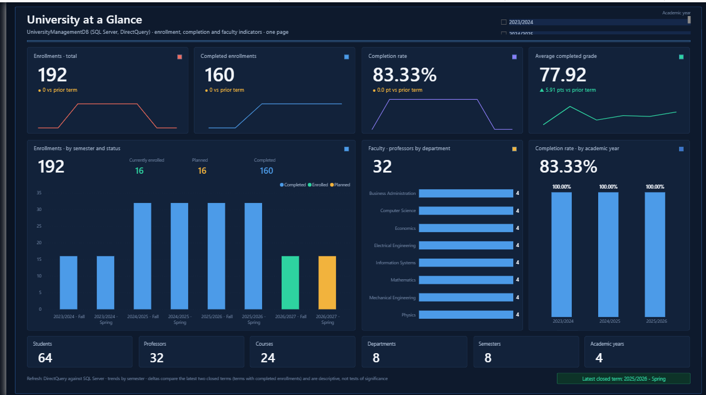

# University-Management-System-End-to-End
End-to-end University Management System using SQL Server, ERD, Data Modeling, SQL Verification, and Power BI DirectQuery
## نتائج اختبار SQL

أُجريت الاختبارات على قاعدة UniversityManagementDB_Test.

### نتيجة Schema Audit

- عدد الجداول: 21.
- عدد الأعمدة: 64.
- عدد Foreign Keys: 30.
- عدد الفحوص: 147.
- عدد الفحوص الفاشلة: 0.
- النتيجة: PASS.

### نتيجة Final Integrity Audit

- إجمالي السجلات الفعلي والمتوقع: 969.
- عدد الفحوص: 135.
- الفحوص الناجحة: 133.
- الفحوص الفاشلة: 0.
- البنود التي تتطلب مراجعة: 2.
- النتيجة الإجمالية: REVIEW.

### قرارات الأعمال المفتوحة

- القرار OBD-01: يوجد 16 طالبًا دون UniversityIDCard؛ توقيت إلزامية إصدار البطاقة يحتاج إلى اعتماد.
- القرار D-18: يوجد 16 زوجًا من Student وResearchProject في ResearchParticipation دون سجل مقابل في ResearchCollaboration؛ توقيت إلزامية التعاون يحتاج إلى اعتماد.

تظل هذه البنود مفتوحة، ولا تُعد النتيجة الإجمالية PASS غير مشروط.

### أدلة الاختبار

- [نتيجة Schema Audit](Test_Evidence/01_Schema_Audit.png)
- [ملخص Final Integrity Audit](Test_Evidence/02_Final_Integrity_Audit.png)
- [قرارات الأعمال المفتوحة](Test_Evidence/03_Open_Business_Decisions.png)
- [نتيجة Q20](Test_Evidence/05_Q20_Research_Collaboration.png)

### التصحيحات المنفذة

- استكمال قائمة الأعمدة المتوقعة في Schema Audit.
- إضافة تنظيف الجدول المؤقت #ActualFK للسماح بإعادة تشغيل الفحص.
- إصلاح بداية التعليق في Department seed script.

### حالة Power BI

اكتمال اختبار SQL لا يثبت اكتمال Power BI؛ يُوثَّق الاتصال والتقرير بعد تنفيذهما والتحقق منهما
## معاينة تقرير Power BI

يتضمن التقرير ست صفحات تغطي مؤشرات الجامعة، والتسجيل، والأداء الأكاديمي، وأعضاء هيئة التدريس، والأنشطة والشبكات البحثية.

[استعراض الصفحات الست للتقرير](Phase_5_Business_Queries_PowerBI_Analytics/README.md)

[تحميل تقرير Power BI بصيغة PBIX](Phase_5_Business_Queries_PowerBI_Analytics/PowerBI/University_Management_Analytics_v2.pbix).
